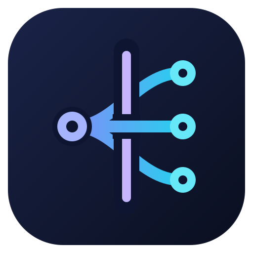
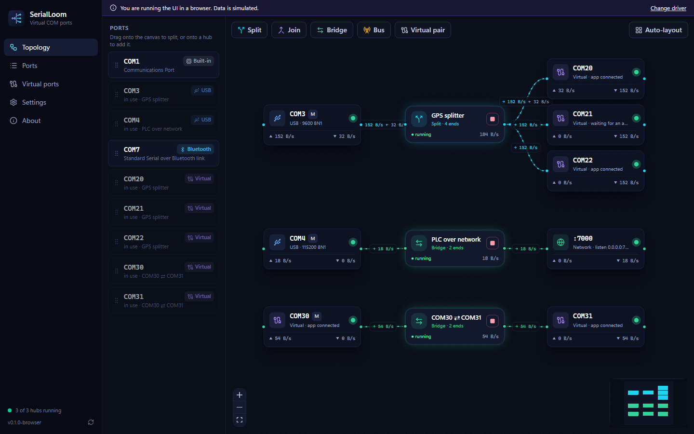

<div align="center">



# SerialLoom

**Weave serial ports together.**
Create virtual COM ports, split one port between many apps, join ports, and bridge serial devices to the network, all in a live visual editor.

[](https://github.com/RahulP5/SerialLoom/actions/workflows/ci.yml)
[](LICENSE)




</div>

## Why SerialLoom

Many tools, from navigation software to PLC programmers, talk to devices over serial (COM) ports. Usually only one program can open a port at a time, and two programs cannot talk to each other without a cable. SerialLoom fixes both:

- **Self-contained.** One installer. Virtual ports use Windows' own USB serial driver, so nothing else needs installing or test mode.
- **Visual.** Ports and connections appear as a live graph with throughput on every link.
- **Open source.** MIT licensed and written in Rust.

## Features

| | |
|---|---|
| **Virtual COM ports** | Create `COM20`, `COM21`, … that any Windows program can open. Baud rate, timeouts, DTR/RTS and `WaitCommEvent` behave like a real port. |
| **Virtual null-modem pairs** | Two virtual ports wired together, so two programs can talk as if connected by a cable. |
| **Split** | Share one physical port (e.g. a GPS on `COM3`) with several programs. Each gets its own virtual port. |
| **Join** | Merge several ports into one virtual port. |
| **Bridge** | Wire any two endpoints: COM ↔ COM, COM ↔ TCP server, COM ↔ TCP client. |
| **Bus** | Every endpoint hears every other, like an RS-485 multidrop line. |
| **Live topology** | Drag ports onto the canvas, watch data flow, inspect bytes in the traffic monitor (ASCII or hex). |
| **Any baud rate** | Programs pick any speed (300 to 12 Mbaud, standard or custom) and framing; the topology shows what each program chose. Virtual ports move data at full speed whatever the setting. Real ports use the speed you set for them. |
| **Persistent** | Connections are saved and can start automatically with SerialLoom. |
| **Runs in the background** | Closing the window keeps SerialLoom in the notification area, so ports stay open. *Quit SerialLoom* in the icon's menu closes every port. |
| **Light and dark themes** | Follows Windows, or choose one in *Settings*. |

## Install

Download the latest installer from [Releases](https://github.com/RahulP5/SerialLoom/releases) and run it. The installer sets up everything virtual ports need, including the bundled virtual USB controller. Windows asks for administrator permission when you create, renumber or remove virtual ports.

Requirements: Windows 10 version 1803 or later, or Windows 11, x64.

> Virtual COM ports work on any Windows 10/11 PC with no test mode. SerialLoom presents each port to Windows as a software USB serial device, served by Windows' own driver through a bundled, Microsoft-signed virtual USB controller ([usbip-win2](https://github.com/vadimgrn/usbip-win2), BSD-2-Clause). See [docs/USB_PORTS.md](docs/USB_PORTS.md). The installer itself is not code-signed yet, so Windows SmartScreen may ask you to confirm (*More info* > *Run anyway*).

## Quick start

1. **Split a port:** drag `COM3` from the port list onto the canvas, keep the two "New virtual port" outputs, and press *Create split*. Point each app at one of the new COM ports.
2. **Null-modem pair:** press *Virtual pair* in the toolbar. Open each of the two ports in a different program.
3. **Serial over the network:** choose *Bridge*, pick your serial port as side A and *TCP server* `0.0.0.0:7000` as side B.

## Build from source

```powershell
# Prerequisites: Rust (MSVC), Node.js 20+, and for the driver: WDK + LLVM 17 (see docs/DRIVER.md)
git clone https://github.com/RahulP5/SerialLoom.git
cd SerialLoom
npm install

.\scripts\fetch-usbip-win2.ps1                  # fetch the Microsoft-signed virtual USB controller
.\drivers\serialloom-port\package.ps1 -NoSign   # build SerialLoom's own (optional) driver package
npm run app:dev                                 # run the app in development mode
npm run app:build                               # build the installer
```

To work on the UI only, run `npm run dev` and open http://localhost:1420. In a plain browser the UI uses simulated data.

## Project layout

```
crates/serialloom-core        routing engine, driver management, persistence (no UI)
crates/serialloom-proto       contract shared by the driver and the app
crates/serialloom-port-logic  serial port behaviour used by the driver (unit tested)
drivers/serialloom-port       UMDF 2 virtual serial port driver (Rust)
src-tauri                     desktop shell and commands (Tauri 2)
src                           React + TypeScript UI (React Flow, Tailwind)
docs                          architecture and driver guides
```

Read [docs/ARCHITECTURE.md](docs/ARCHITECTURE.md) for how the pieces fit together.

## Roadmap

- Run the routing engine as a Windows service, so connections keep working while the window is closed
- Pass baud rate and modem lines through end to end (RFC 2217 for TCP)
- Port renaming and per-port settings in the UI
- Command-line interface for scripting
- Linux support using pseudo-terminals

## Feedback

SerialLoom is developed by [Rahul Pachpind](https://github.com/RahulP5). Bug reports and ideas are welcome in [Issues](https://github.com/RahulP5/SerialLoom/issues). To report a vulnerability, see [SECURITY.md](SECURITY.md).

## License

[MIT](LICENSE) © 2026 [Rahul Pachpind](https://github.com/RahulP5)
